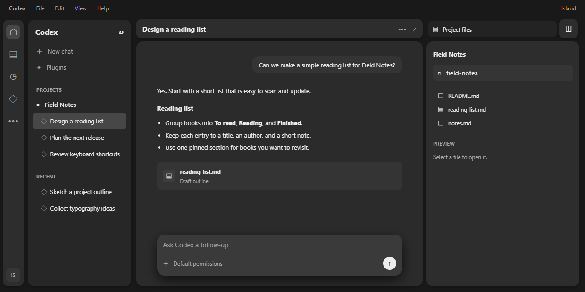
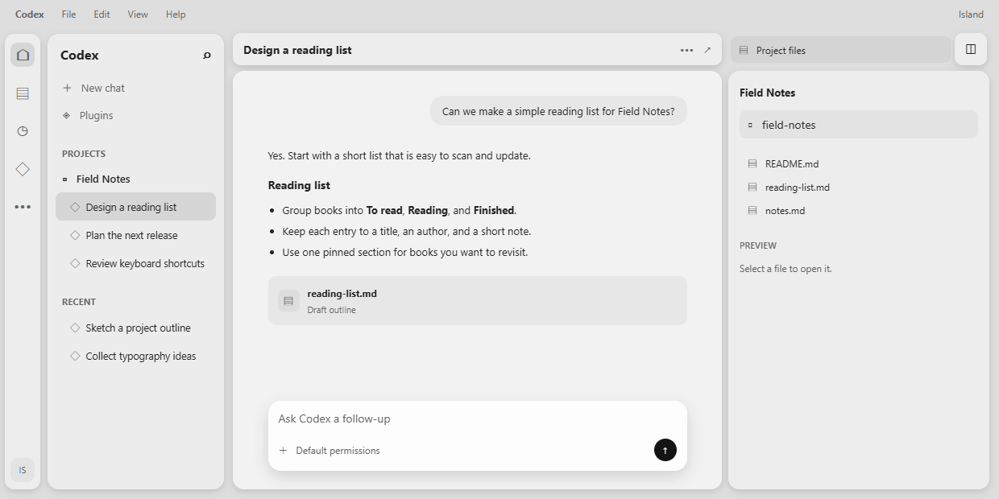

# Island for Codex

Island 是一个 CodexHost 桌面端外观扩展。它把侧栏、对话区和输入框分成圆角悬浮面板，用底色和间距划分区域。

## 安装和使用

1. 从 GitHub Releases 下载 ZIP，在 CodexHost 插件中心本地导入。通过市场审核后，也可以在插件中心搜索 Island 安装。
2. 打开 Codex 的「设置 → 外观 → 主题 → 自定义主题」，选择「island 毛玻璃」。
3. 在同一页自定义窗口底色、左侧会话栏、中间对话区和右侧面板。每项都可以单独恢复默认。
4. 鼠标靠近聊天内容的左边或右边时，会出现一小段拖动线。拖动可以调整对话宽度，双击恢复默认。

Island 适配浅色和深色模式，并分别保存两套配色。对话宽度也会保存。

## English

Island is an appearance extension for Codex Desktop running through CodexHost. It gives the sidebar, chat area, and composer their own rounded surfaces, with a compact layout in light and dark mode.

Download the ZIP from GitHub Releases and import it in the CodexHost extension center. After marketplace approval, you can also search for Island there. In Codex, open **Settings → Appearance → Theme → Custom themes** and choose **island 毛玻璃**. Set and reset the window, conversation list, chat area, and right-panel colors individually. Hover near either edge of the conversation and drag to resize, or double-click to reset.
